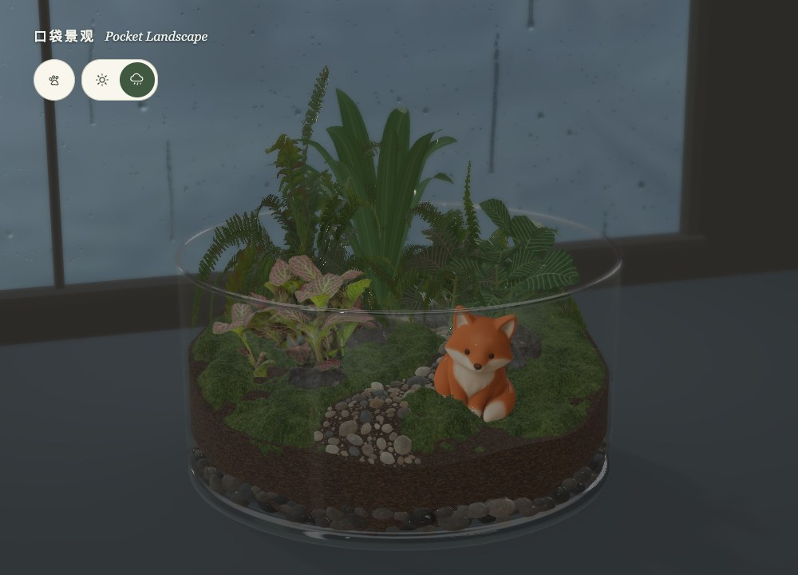
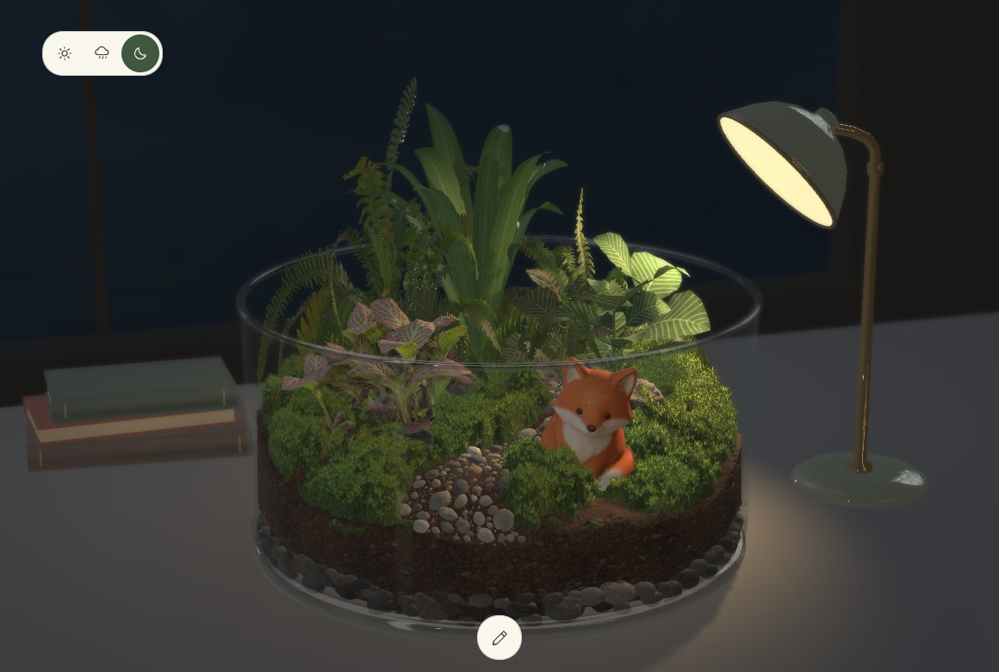
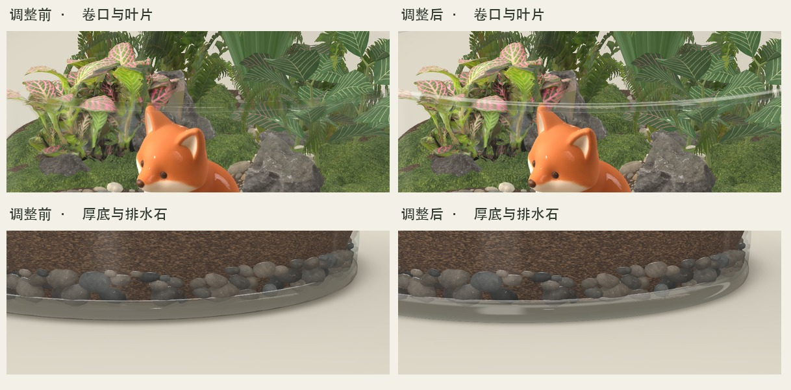
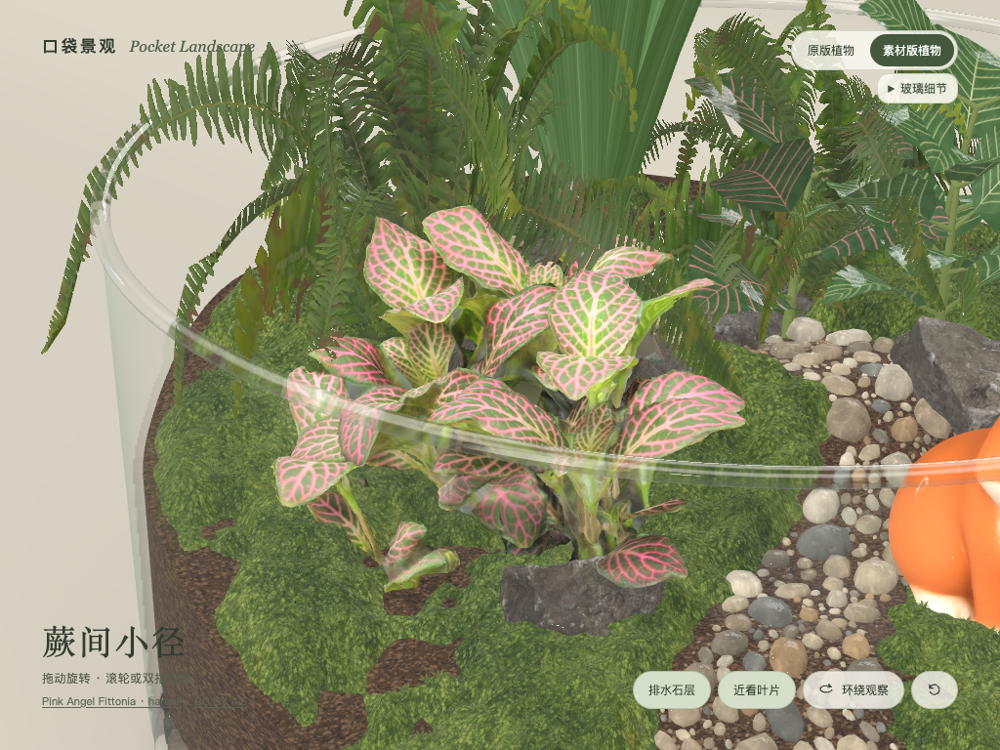

# Pocket Landscape · Fern Path

[简体中文](README.md) · **English**

A miniature terrarium you can turn in your hand. Pink-veined fittonia and ferns grow above the glass rim, and a clay fox sits beside a winding pebble path. Look through the lower wall to see the soil and drainage stones beneath the moss.


## Open the terrarium

Run these commands from the repository root. The build bundles Babylon.js, the models, textures and environment map into a single page.

```sh
npm ci
npm run build
```

For web hosting, run `npm run build:web` and publish the contents of `dist/`, keeping `index.html` alongside `assets/`. The browser loads animal models on demand.

Open the generated `index.html` in a WebGL 2 browser to explore offline. Drag to orbit, and use the scroll wheel or pinch to zoom.

Select the pencil to edit a working copy of Fern Path from the current camera angle and in the same weather. On first use, a message beside the pencil shows while the tools initialize. Select the eye to view the original, then the pencil to resume your edits. With the hand tool, tap a rock, path pebble, plant or fox, then tap the ground to move it or press Delete or Backspace to remove it. Tap the original moss bed with the eraser to expose a patch of soil, then use a planting tool to replant it. Open the folder to save a named copy, reopen a previous one, or start from the original scene. Each copy is stored independently in this browser.

In the editor’s scene menu, choose “Start from Pebble Slope” to pour pebbles down a planted bank. With the hand tool, select either rock at the foot of the slope and tap a new spot on the soil. Pour again to see how the path changes.

Select the jar with a plus sign in the folder menu to build a landscape in an open jar, a slant-cut glass bowl, or a corked shoulder bottle. Tap inside with the soil tool to build a slope. In the slant-cut bowl, add soil just behind the low front lip to watch the slope spread and clods spill onto the desk. Each scoop and its spill can be undone together. Open the stone picker to scatter a handful of pebbles or place a single landscape rock. Use the move tool to reposition the rock. For pebbles, tap to pour eight or hold to preview a larger handful, then release to pour up to 24. Open the leaf icon to choose moss, a fern or pink fittonia, then tap the ground to plant it. Tap the leaves with the eraser to remove a whole plant, or erase a stone, moss patch or mound. Use the stopper icon to set the cork beside the bottle or seal it again. The cork stays in the selected position while you edit. The vessel and layout are saved in this browser.

In the editor, select the paw, choose a fox, resting fawn or hedgehog, and tap the ground to add it. You can place several figurines together. Select one with the move tool to reposition it, choose another thumbnail to replace it, or use the curved arrows or Q / E to rotate it by 15°. Use the eraser to remove it. The undo and redo buttons step through your edits, with each handful of pebbles counting as one step. Use Cmd / Ctrl + Z to undo and add Shift to redo. Layouts save automatically. Undo history lasts for the current session.

Select the sun, rain cloud or moon to switch between morning, rain and night. In the editor, use the hand tool to select the lamp or the stack of books, then tap a clear spot on the tabletop to place it. At night, the desk lamp lights the moss bank and foliage from the side, casting a warm pool of light against the cool window. On rainy days, dim blue-grey light catches the rim and leaves, fading across the desk into the room. Beads cling to the pane and merge on contact. Heavier drops slide down the glass and veer slightly in gusts, clearing fine beads and drawing short ribbons of water that fade back to a trail of beads. With reduced motion enabled, the drops stay still.






## Rendering techniques

| What to look for | How it is rendered |
| --- | --- |
| Glass wall, rolled rim and thick foot | Babylon.js revolves three cross-sections into separate meshes. In high-quality mode, a shared half-resolution, linear half-float render target captures the contents of the vessel. The thin-wall shader uses thickness and incidence angle to compute refraction and absorption. The rim and foot sample the same capture through physically based materials. HDR reflections and window highlights travel along their curved surfaces as you orbit. [Glass implementation](source/glass.js) |
| Window light and shadows | A studio HDR environment supplies ambient light and reflections. A directional light stands in for the window. A shallow sill and one off-center mullion frame the view behind the terrarium. A separate glass pane sits in front of the soft-focus landscape. Light entering through the modeled window casts real-time shadows on the planting and tabletop through a 2048 × 2048 contact-hardening shadow map. The soft mullion shadow follows the same light direction. A light-aligned shader approximates the bright caustic arc near the foot. [Scene lighting](source/scene.js) |
| Fittonia, fern and canopy leaves | Diffuse transmission takes its color from the leaf pigment. Fittonia has a soft sheen, while fern leaflets carry a faint waxy reflection. The procedural leaves transmit less light along the midrib. Each fern has subtly crown-oriented normals and a darker base. Cutout coverage compensation helps distant leaflets hold their shape. [Foliage shading](source/foliage.js) · [Matched views](docs/foliage-detail.jpg) |
| Moss, path and drainage bed | Cushions of different heights meet the figurine’s paws. Low Fittonia leaves overhang the bend in the path. Along the front glass, a fringe of moss spills over the bank and soil fills pockets between drainage stones. Flat path pebbles sit partly below the soil, while coarser drainage stones nest against the inner wall. Geometry defines silhouettes and gaps. Color, normal and roughness maps supply the close-up grain. Patches of darker color and lower roughness suggest damp contact between soil and stone. [Moss bed](source/terrarium-floor.py) · [Path](source/path-gravel.py) · [Drainage](source/drainage.js) |

[Compare the moss cushions and soil face from the same camera position](docs/moss-soil-comparison.jpg)

A subtle depth-of-field effect keeps the camera focused on the clay figurine beside the path. As you orbit or zoom in, the surrounding moss retains its texture while the distant window frame and raindrops soften.

Ground mist follows the moss banks and fades before it reaches the glass. It is faint in morning light and denser in rain. Scene depth occludes the mist behind solid objects, and the glass captures it for refraction. Append `?mist=0` to compare the same view without ground mist. [Rainy close-up, mist off on the left and on at right](docs/moss-mist.jpg)

In high-quality mode, mist and droplets follow the curved wall. Droplets stay still when reduced motion is enabled. Coarse-pointer devices and devices without the required half-float texture support use lightweight Fresnel glass. Append `?glass=lightweight` to compare the two. [Glass close-ups and implementation notes (Chinese)](docs/glass-optics.md)



## Edit the scene in Blender

`woodland.blend` and `woodland.glb` contain the base garden. `woodland-specimens.blend` and `woodland-specimens.glb` contain the complete scanned-plant version. The viewer loads shared terrain, rocks and props from the base GLB, then loads the foreground fittonia and two ferns from `source/assets/specimens/plants.glb`. The bundled assets are sufficient to build the page.

To regenerate the base garden, run the following from the repository root. The texture script requires Python and Pillow. Substitute the path to your Blender executable for `blender` if needed.

```sh
cd source
python3 textures.py ./textures
blender -b -P model.py -- "$PWD/textures" "$PWD/.."
cd ..
```

To regenerate the scanned-plant version, unpack the source archive inside the original Sketchfab ZIP. Replace the path below with the directory containing `model.glb` and its textures. Run these commands from the repository root.

```sh
blender -b -P source/specimens.py -- "/path/to/extracted/scan" "$PWD"
npm run build
```

## Assets and landscape references

- The desk stack uses three bindings (cloth-backed Bodoni, paperback and hardcover) generated with [irma-book](https://github.com/fabiosantaniellobruun/irma-book) (MIT), with custom cloth, botanical detailing and paper edges.
- **Pink Angel Fittonia** is a photogrammetry scan by harenil. The plant was scaled, rotated, positioned and simplified to 44,910 triangles after removing scan artifacts between the leaves. Its diffuse texture was reduced from 8K to 2K. The offline page also includes the attribution and license in its asset metadata. [Original model](https://sketchfab.com/3d-models/pink-angel-fittonia-130670511c9144b6ac8aeb7b9f00482c) · [CC BY 4.0](https://creativecommons.org/licenses/by/4.0/)
- **Ferns** use variants B and C of Fern 02 by Rico Cilliers and Rob Tuytel, scaled and oriented to fit the glass. Fronds near the wall turn inward about their petioles, keeping their drooping shape and clearing the rolled rim. [Fern 02](https://polyhaven.com/a/fern_02) · [CC0](https://polyhaven.com/license)
- **The six landscape rocks** come from Rock Moss Set 01 by Kless Gyzen. Each rock was simplified, rotated and seated in the moss bed. The color map was adjusted to mute the brown tones while preserving moss patches, normals and roughness detail. [Rock Moss Set 01](https://polyhaven.com/a/rock_moss_set_01) · [CC0](https://polyhaven.com/license) · [Rock close-ups](docs/outcrop-detail.jpg)
- **Moss and soil** use Moss 003 from ambientCG and Brown Mud Rocks 01 from Poly Haven. The former supplies moss color, normal and height detail. The latter supplies soil roughness. Soil color and normals are baked from the same procedural grain profile. [Moss 003](https://ambientcg.com/a/Moss003) · [ambientCG CC0](https://docs.ambientcg.com/license/) · [Brown Mud Rocks 01](https://polyhaven.com/a/brown_mud_rocks_01) · [Poly Haven CC0](https://polyhaven.com/license) · [Path and drainage close-ups](docs/pebble-detail.jpg)
- **Window raindrops** use the droplet shape and refraction maps by Lucas Bebber for Codrops. A water map tracks thickness and coverage. The shader samples a sharper version of the outdoor photograph inside each drop. [Rain & Water Effect Experiments](https://github.com/codrops/RainEffect)
- **The view through the window** is a desaturated, defocused crop of Spruit Sunrise by Greg Zaal. [Spruit Sunrise](https://polyhaven.com/a/spruit_sunrise) · [CC0](https://polyhaven.com/license)
- **Environment lighting** uses Studio Small 09 by Sergej Majboroda. [Studio Small 09](https://polyhaven.com/a/studio_small_09) · [CC0](https://polyhaven.com/license)
- **The clay figurines** use fox, fawn and hedgehog models supplied by the project author. Each new model has 33,000 triangles and 1K textures. The offline viewer decodes each GLB on first selection. The planting draws on a miniature hillside path by Kokemusubi and a white-gravel path by Kakikuke Koke. [Hillside path](https://kokemusubi-shop.com/products/kaidanll_selectfigure) · [White-gravel path](https://minne.com/items/46157867)


