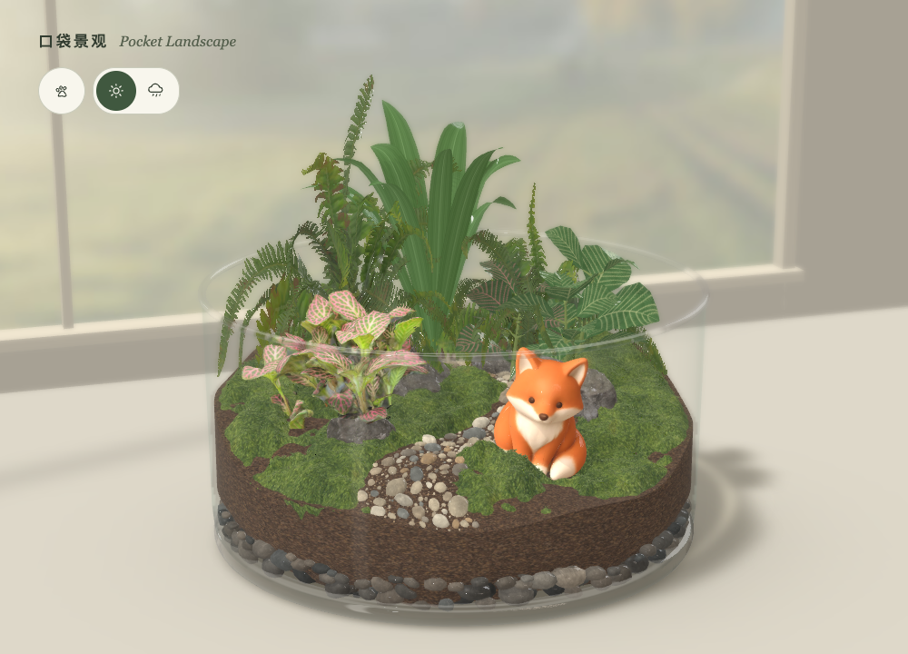
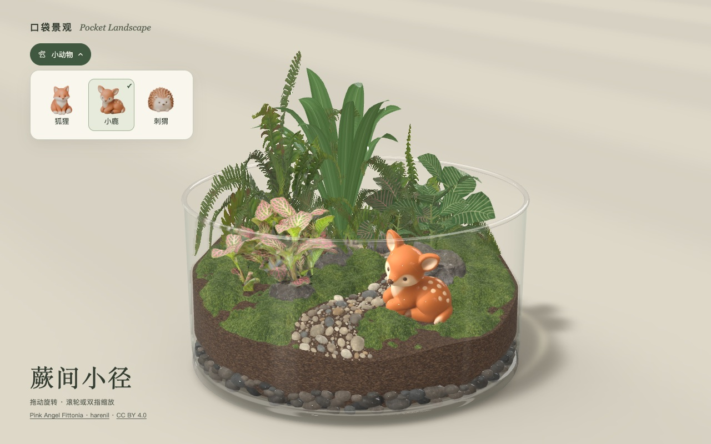

# Pocket Landscape · Fern Path

[简体中文](README.md) · **English**

A miniature terrarium you can turn in your hand. Pink-veined fittonia and ferns grow above the glass rim, and a clay fox sits beside a winding pebble path. Look through the lower wall to see the soil and drainage stones beneath the moss.



## Open the terrarium

Run these commands from the repository root. The build bundles Babylon.js, the models, textures and environment map into a single page.

```sh
npm ci
npm run build
```

Open the generated `index.html` in a WebGL 2 browser to explore offline. Drag to orbit, and use the scroll wheel or pinch to zoom.

Open **小动物** (Animals) in the upper left to choose the fox, resting fawn or hedgehog.

Select **晨光** (Morning) or **雨天** (Rain) beside the animal selector. On rainy days, dim blue-grey light catches the rim and leaves, fading across the desk into the room. Larger drops slide down the window and refract the landscape outside. With reduced motion enabled, the drops stay still.




## Rendering techniques

| What to look for | How it is rendered |
| --- | --- |
| Glass wall, rolled rim and thick foot | Babylon.js revolves three cross-sections into separate meshes. In high-quality mode, a shared half-resolution, linear half-float render target captures the contents of the vessel. The thin-wall shader uses thickness and incidence angle to compute refraction and absorption. The rim and foot sample the same capture through physically based materials. HDR reflections and window highlights travel along their curved surfaces as you orbit. [Glass implementation](source/glass.js) |
| Window light and shadows | A studio HDR environment supplies ambient light and reflections. A directional light stands in for the window. A modeled sill and sash bars frame the morning view behind the terrarium. A separate glass pane sits in front of the soft-focus landscape. Plants and stones cast shadows on each other through a 2048 × 2048 shadow map with percentage-closer filtering (PCF). The soft tabletop shadow is baked from the model silhouette. A light-aligned shader approximates the bright caustic arc near the foot. [Scene lighting](source/scene.js) · [Tabletop shadow bake](source/shadow.py) |
| Fittonia, fern and canopy leaves | Diffuse transmission takes its color from the leaf pigment. Fittonia has a soft sheen, while fern leaflets carry a faint waxy reflection. The procedural leaves transmit less light along the midrib. Each fern has subtly crown-oriented normals and a darker base. Cutout coverage compensation helps distant leaflets hold their shape. [Foliage shading](source/foliage.js) · [Matched views](docs/foliage-detail.jpg) |
| Moss, path and drainage bed | Small clusters of shoots break up the moss surface as it follows the terrain. Flat path pebbles sit partly below the soil, while coarser drainage stones nest against the inner wall. Geometry defines silhouettes and gaps. Color, normal and roughness maps supply the close-up grain. Patches of darker color and lower roughness suggest damp contact between soil and stone. [Moss bed](source/terrarium-floor.py) · [Path](source/path-gravel.py) · [Drainage](source/drainage.js) |

In high-quality mode, mist and droplets follow the curved wall. Droplets stay still when reduced motion is enabled. Coarse-pointer devices and devices without the required half-float texture support use lightweight Fresnel glass. Append `?glass=lightweight` to compare the two. [Glass close-ups and implementation notes (Chinese)](docs/glass-optics.md)


## Edit the scene in Blender

`woodland.blend` and `woodland.glb` contain the base garden. `woodland-specimens.blend` and `woodland-specimens.glb` contain the complete scanned-plant version. The viewer loads shared terrain, rocks and props from the base GLB, then loads the foreground fittonia and two ferns from `source/assets/specimens/plants.glb`. The bundled assets are sufficient to build the page.

To regenerate the base garden, run the following from the repository root. The texture and shadow scripts require Python and Pillow. Substitute the path to your Blender executable for `blender` if needed.

```sh
cd source
python3 textures.py ./textures
blender -b -P model.py -- "$PWD/textures" "$PWD/.."
python3 shadow.py ../woodland.glb assets/shadow.png
cd ..
```

To regenerate the scanned-plant version, unpack the source archive inside the original Sketchfab ZIP. Replace the path below with the directory containing `model.glb` and its textures. Run these commands from the repository root. The second command updates the tabletop shadow used by the viewer.

```sh
blender -b -P source/specimens.py -- "/path/to/extracted/scan" "$PWD"
python3 source/shadow.py woodland-specimens.glb source/assets/specimens/shadow.png
npm run build
```

## Assets and landscape references

- **Pink Angel Fittonia** is a photogrammetry scan by harenil. The plant was scaled, rotated, positioned and simplified to 45,397 triangles. Its diffuse texture was reduced from 8K to 2K. The offline viewer includes the attribution and license links. [Original model](https://sketchfab.com/3d-models/pink-angel-fittonia-130670511c9144b6ac8aeb7b9f00482c) · [CC BY 4.0](https://creativecommons.org/licenses/by/4.0/)
- **Ferns** use variants B and C of Fern 02 by Rico Cilliers and Rob Tuytel, scaled and oriented to fit the glass. Fronds near the wall turn inward about their petioles, keeping their drooping shape and clearing the rolled rim. [Fern 02](https://polyhaven.com/a/fern_02) · [CC0](https://polyhaven.com/license)
- **The six landscape rocks** come from Rock Moss Set 01 by Kless Gyzen. Each rock was simplified, rotated and seated in the moss bed. The color map was adjusted to mute the brown tones while preserving moss patches, normals and roughness detail. [Rock Moss Set 01](https://polyhaven.com/a/rock_moss_set_01) · [CC0](https://polyhaven.com/license) · [Rock close-ups](docs/outcrop-detail.jpg)
- **Moss and soil** use Moss 003 from ambientCG and Brown Mud Rocks 01 from Poly Haven. The former supplies moss color, normal and height detail. The latter supplies soil normals and roughness. [Moss 003](https://ambientcg.com/a/Moss003) · [ambientCG CC0](https://docs.ambientcg.com/license/) · [Brown Mud Rocks 01](https://polyhaven.com/a/brown_mud_rocks_01) · [Poly Haven CC0](https://polyhaven.com/license) · [Path and drainage close-ups](docs/pebble-detail.jpg)
- **The view through the window** is a desaturated, defocused crop of Spruit Sunrise by Greg Zaal. [Spruit Sunrise](https://polyhaven.com/a/spruit_sunrise) · [CC0](https://polyhaven.com/license)
- **Environment lighting** uses Studio Small 09 by Sergej Majboroda. [Studio Small 09](https://polyhaven.com/a/studio_small_09) · [CC0](https://polyhaven.com/license)
- **The clay figurines** use fox, fawn and hedgehog models supplied by the project author. Each new model has 33,000 triangles and 1K textures. The offline viewer decodes each GLB on first selection. The planting draws on a miniature hillside path by Kokemusubi and a white-gravel path by Kakikuke Koke. [Hillside path](https://kokemusubi-shop.com/products/kaidanll_selectfigure) · [White-gravel path](https://minne.com/items/46157867)


