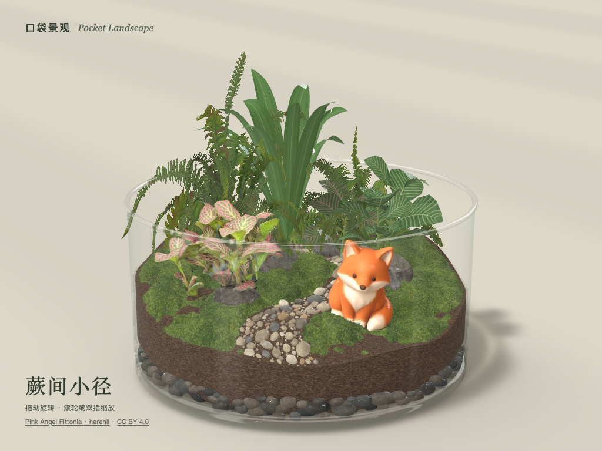
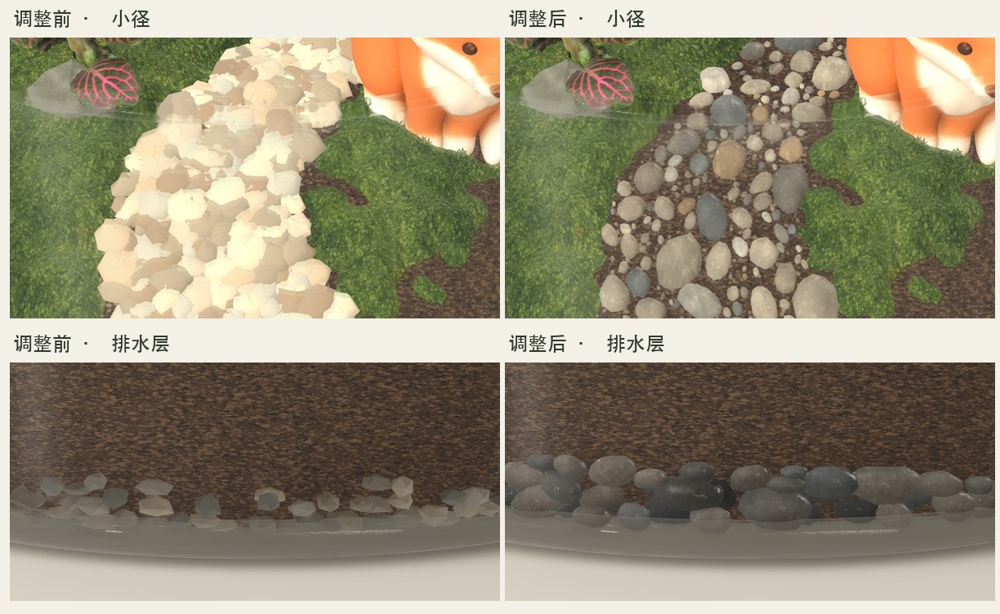
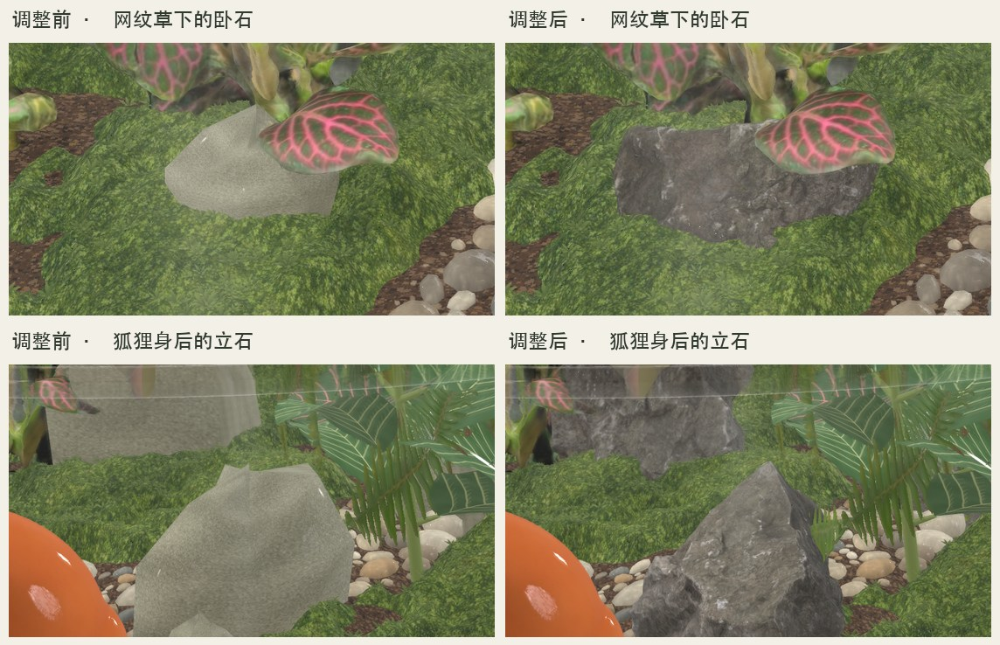

# Pocket Landscape · 蕨间小径

使用 Babylon.js 渲染的可旋转玻璃微景观，包含网纹草、蕨类、苔藓和陶土狐狸。



小径的扁卵石顺着弯道嵌入土面，石缝间留有细砾。透过杯壁可以看到更粗的灰褐色排水石。



在仓库根目录运行以下命令构建离线网页。

```sh
npm ci
npm run build
```

在支持 WebGL 2 的桌面浏览器中打开生成的 `index.html` 即可离线观察。拖动旋转，滚轮或双指缩放。卷口、厚底的同机位对照和水汽参数说明见[玻璃渲染笔记](docs/glass-optics.md)。

woodland.blend 是内景的可编辑 Blender 工程，已经打包纹理。woodland.glb 是导出的内景。玻璃器皿、窗光、桌面和观察相机在 source/scene.js 中实时创建。

## 重新构建

网页构建使用仓库内的 GLB 和纹理，可独立于 Blender 运行。若通过 Blender 调整了植物位置，将 GLB 导出到原位置，再在 `source` 中运行 `python3 shadow.py ../woodland.glb assets/shadow.png` 更新桌面投影。这个脚本需要 Pillow。

从头生成内景时，在 source 中依次执行以下命令。将 blender 替换为本机 Blender 可执行文件路径。

```sh
python3 textures.py ./textures
blender -b -P model.py -- "$PWD/textures" "$PWD/.."
python3 shadow.py ../woodland.glb assets/shadow.png
cd ..
npm run build
```

## 素材来源

植株间的六块景石采用 Kless Gyzen 的 Rock Moss Set 01。六块石形分别简化，沿坡度旋转、埋入苔床，颜色贴图降低了棕色饱和度，保留苔斑、法线与粗糙度细节。[Rock Moss Set 01](https://polyhaven.com/a/rock_moss_set_01) · [CC0](https://polyhaven.com/license)



苔面使用 ambientCG 的 Moss 003 颜色、法线和高度纹理。地形和表面的细叶簇在 Blender 中生成，小径边缘与狐狸脚下留出裸土。[Moss 003](https://ambientcg.com/a/Moss003) · [CC0](https://docs.ambientcg.com/license/)

环境光采用 Sergej Majboroda 的 Studio Small 09。[Studio Small 09](https://polyhaven.com/a/studio_small_09) · [CC0](https://polyhaven.com/license)

造景参考了苔むすび的微缩山道和カキクケ苔的白砂小径。小径旁的摆件使用项目作者提供的 Tripo 模型《圆润陶土狐狸摆件》，网页版保留原模型的颜色、法线和粗糙度贴图。[階段の風景](https://kokemusubi-shop.com/products/kaidanll_selectfigure) · [流木の隠れ家と森の番人](https://minne.com/items/46157867)

## 植物对照版


页面展示素材版植物。woodland-specimens.blend 和 woodland-specimens.glb 包含完整的素材版内景。woodland.blend 和 woodland.glb 对应原版内景。

前景使用 harenil 摄影扫描的 Pink Angel Fittonia，依据 CC BY 4.0 修改。修改包括缩放、旋转、定位、几何简化至 45,397 个三角形，以及将 8K 漫反射贴图缩为 2K。作者、来源与许可也标注在离线网页中。[原作品](https://sketchfab.com/3d-models/pink-angel-fittonia-130670511c9144b6ac8aeb7b9f00482c) · [CC BY 4.0](https://creativecommons.org/licenses/by/4.0/)

后景采用 Rico Cilliers 和 Rob Tuytel 的 Fern 02 中 B、C 两丛，使用独立的叶缘透明遮罩，调整了尺寸和朝向。[Fern 02](https://polyhaven.com/a/fern_02) · [CC0](https://polyhaven.com/license)

需要从原始扫描重新生成素材版时，先将 Sketchfab 原始 ZIP 内的 source 压缩包解到一个目录，保留 model.glb 和同目录贴图。用 Blender 运行 source/specimens.py，两个参数依次为解压目录和本项目目录。再用 source/shadow.py 将 woodland-specimens.glb 的桌面投影写入 source/assets/specimens/shadow.png，最后在仓库根目录运行 `npm run build`。直接重建网页只需要已打包的文件。
