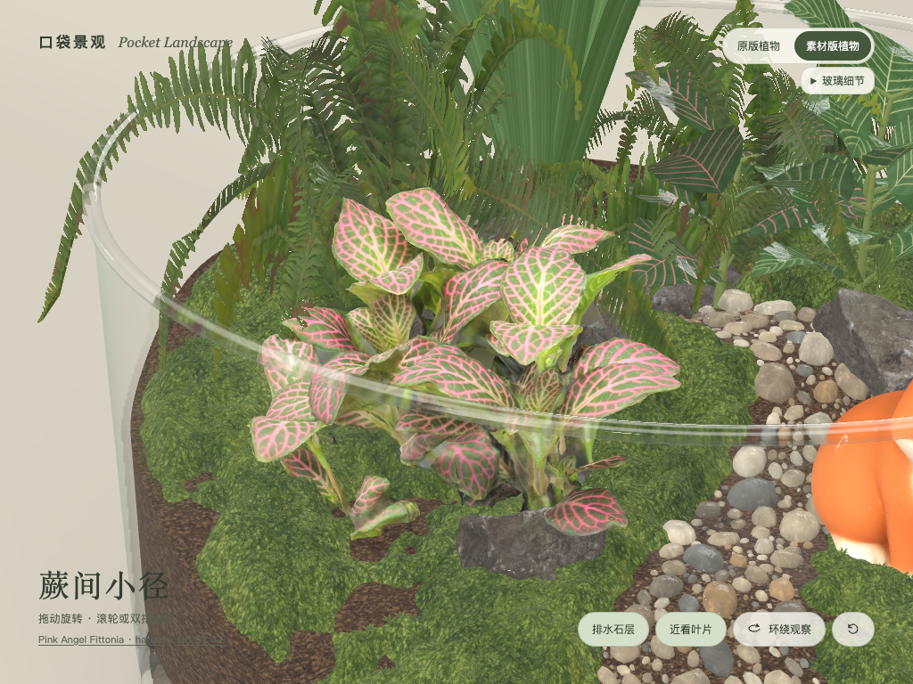

# Pocket Landscape · 蕨间小径

**简体中文** · [English](README.en.md)

一个可以捧在手里转动的数字微景观。粉脉网纹草和蕨叶从玻璃杯口探出，一只陶土狐狸坐在卵石小径旁。沿杯壁往下看，还能看到苔坡下面的泥土和排水石。


## 打开景观

在仓库根目录运行以下命令。构建会把 Babylon.js、模型、贴图和环境光打包进同一个网页。

```sh
npm ci
npm run build
```

用支持 WebGL 2 的浏览器打开生成的 `index.html` 即可离线观察。拖动旋转视角，滚轮或双指缩放。

展开左上角的「小动物」可在狐狸、卧姿小鹿和刺猬之间切换。

点击旁边的「晨光」或「雨天」切换天气。阴雨天里，微弱的灰蓝色窗光勾出杯沿和叶片轮廓，桌面朝室内渐暗。小水珠附在窗上，相遇后会合并；较重的水滴沿玻璃滑落，扫开细珠并留下断续的水痕。启用系统的「减少动态效果」时，雨滴保持静止。


## 渲染技术

| 看哪里 | 如何渲染 |
| --- | --- |
| 杯壁、卷口与厚底 | Babylon.js 分别旋转截面曲线生成三部分几何体。桌面高画质模式用一张半分辨率、线性半浮点渲染目标捕捉缸内景物。薄壁着色器按厚度和入射角计算折射偏移与吸收，卷口和底足的 PBR 材质共用这张纹理。转动视角时，HDR 环境反射和窗光高光沿圆角移动。[玻璃实现](source/glass.js) |
| 窗光与投影 | 棚拍 HDR 提供环境光和反射，方向光模拟窗光。缸后有带窗台和十字窗棂的立体窗框，独立的窗玻璃位于柔焦远景前方。2048 × 2048 的 PCF 阴影贴图让植物和石头彼此投影，桌面的柔影则从模型轮廓离线烘焙。玻璃底部附近的亮弧由方向光驱动的着色器近似焦散。[场景灯光](source/scene.js) · [桌面投影](source/shadow.py) |
| 网纹草、蕨叶与长叶 | 叶片的漫透射保留原有色素。网纹草表面的高光柔和，蕨叶带一层很轻的蜡质反光。程序化叶片的中脉比边缘透光少。两丛蕨的羽片法线向各自的冠形轻微靠拢，根部用顶点色压暗；远处细羽片的透明裁切随纹理缩小程度补偿。[植物着色](source/foliage.js) · [同机位对照](docs/foliage-detail.jpg) |
| 苔床、石径与排水层 | 苔面沿地形起伏，表面散布细小叶簇。小径上的扁石部分埋入坡面，底部较粗的排水石沿内壁错叠。真实几何决定轮廓和孔隙，颜色、法线和粗糙度贴图负责近处的颗粒感。土石交界局部压暗并降低粗糙度，呈现湿润感。[苔床](source/terrarium-floor.py) · [小径](source/path-gravel.py) · [排水层](source/drainage.js) |

高画质模式下，凝雾和水珠附着在杯壁上。系统启用「减少动态效果」时，水珠保持静止。触屏粗指针设备或缺少所需半浮点纹理支持的设备使用轻量 Fresnel 玻璃。可用 `?glass=lightweight` 对照两种效果。[玻璃近景与实现笔记](docs/glass-optics.md)


## 在 Blender 中编辑

`woodland.blend` 和 `woodland.glb` 是基础内景，`woodland-specimens.blend` 和 `woodland-specimens.glb` 包含完整的扫描植物版。网页从基础 GLB 加载共用的地形、景石和摆件，再从 `source/assets/specimens/plants.glb` 加载前景网纹草和两丛蕨类。可直接使用仓库内的资产构建网页。

要从头生成基础内景，在仓库根目录运行以下命令。纹理与投影脚本需要 Python 和 Pillow，`blender` 可替换为本机可执行文件的路径。

```sh
cd source
python3 textures.py ./textures
blender -b -P model.py -- "$PWD/textures" "$PWD/.."
python3 shadow.py ../woodland.glb assets/shadow.png
cd ..
```

要重新生成扫描植物版，将 Sketchfab 原始 ZIP 内的 source 压缩包解开，把下方的路径替换为包含 `model.glb` 和贴图的目录。在仓库根目录执行，第二条命令会更新网页使用的桌面投影。

```sh
blender -b -P source/specimens.py -- "/path/to/extracted/scan" "$PWD"
python3 source/shadow.py woodland-specimens.glb source/assets/specimens/shadow.png
npm run build
```

## 素材与造景参考

- **粉脉网纹草**来自 harenil 的 Pink Angel Fittonia 摄影扫描。模型经过缩放、旋转和定位，简化至 45,397 个三角形，漫反射贴图从 8K 缩为 2K。离线网页保留作者与许可链接。[原作品](https://sketchfab.com/3d-models/pink-angel-fittonia-130670511c9144b6ac8aeb7b9f00482c) · [CC BY 4.0](https://creativecommons.org/licenses/by/4.0/)
- **蕨类**采用 Rico Cilliers 和 Rob Tuytel 的 Fern 02 中 B、C 两丛，按杯体调整了尺寸和朝向。靠壁羽片绕各自叶柄向内转，在杯口内侧留出间隙，保留下垂的轮廓。[Fern 02](https://polyhaven.com/a/fern_02) · [CC0](https://polyhaven.com/license)
- **六块景石**来自 Kless Gyzen 的 Rock Moss Set 01。六种石形分别简化、旋转并埋入苔床。颜色贴图降低了棕色饱和度，保留苔斑、法线和粗糙度细节。[Rock Moss Set 01](https://polyhaven.com/a/rock_moss_set_01) · [CC0](https://polyhaven.com/license) · [景石近景](docs/outcrop-detail.jpg)
- **苔面与泥土**分别使用 ambientCG 的 Moss 003 和 Poly Haven 的 Brown Mud Rocks 01。前者提供颜色、法线和高度细节，后者提供土壤法线和粗糙度。[Moss 003](https://ambientcg.com/a/Moss003) · [ambientCG CC0](https://docs.ambientcg.com/license/) · [Brown Mud Rocks 01](https://polyhaven.com/a/brown_mud_rocks_01) · [Poly Haven CC0](https://polyhaven.com/license) · [小径与排水层近景](docs/pebble-detail.jpg)
- **窗上雨滴**采用 Lucas Bebber 为 Codrops 绘制的水滴形状与折射方向贴图。水量图记录水滴的厚度和覆盖范围，着色器在滴内采样另一张更清晰的窗外照片。[Rain & Water Effect Experiments](https://github.com/codrops/RainEffect)
- **窗外晨景**截取自 Greg Zaal 的 Spruit Sunrise 全景照片，经过柔焦和降饱和处理。[Spruit Sunrise](https://polyhaven.com/a/spruit_sunrise) · [CC0](https://polyhaven.com/license)
- **环境光**采用 Sergej Majboroda 的 Studio Small 09。[Studio Small 09](https://polyhaven.com/a/studio_small_09) · [CC0](https://polyhaven.com/license)
- **陶土摆件**使用项目作者提供的狐狸、小鹿和刺猬模型。两款新摆件各简化至 33,000 个三角形，使用 1K 贴图；离线页面在首次选中时解码对应的 GLB。造景参考了苔むすび的微缩山道和カキクケ苔的白砂小径。[階段の風景](https://kokemusubi-shop.com/products/kaidanll_selectfigure) · [流木の隠れ家と森の番人](https://minne.com/items/46157867)


