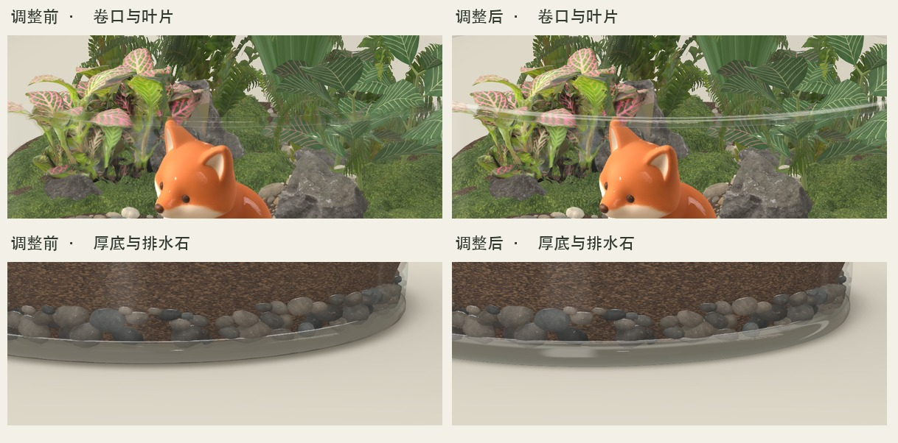

# 蕨间小径：玻璃光学与水汽

这是 [#5](https://github.com/xiaoiver/pocket-landscape/issues/5) 在卷口、底足之后的续作。

- **侧壁**：圆柱外壁用 64×1 单通道厚度图，厚底肩、薄中段、加厚卷口。图值经 0.018–0.048 场景单位范围映射，再按视角延长光路。折射光线按 Snell 定律穿过局部厚度，再把出口重投影到相机。屏幕偏移每轴最多 1.2%，正视薄壁时折射图仅混合 3.4%；线性光中的 Beer–Lambert 衰减使较厚、掠射区域略偏绿。光学厚度用于材质校准，不是几何测量。杯壁、卷口和底足共用一组固定在场景中的窗光和暗部反射，叠加在 HDR 环境反射上。观察角度变化时，高光沿卷口的圆弧和底足的圆角移动。
- **水汽**：浅雾集中在杯口下方的局部区域。水珠沿圆柱切面扰动透射画面，滑动水珠的湿痕留在上方，系统「减少动态效果」会冻结水珠。桌面光斑是按方向光旋转的程序式近似焦散，不是光线追踪。三项默认开启，可用网址参数 `?fog=0&drops=0&caustic=0` 比较。
- **预算**：共享 #7 的一次半分辨率线性半浮点捕捉，不为侧壁再加捕捉；不采样自身。桌面光斑是单张可关闭网格。粗指针或缺少过滤/渲染半浮点支持时保留原轻量玻璃，也可用 `?glass=lightweight`。无新增依赖、联网资源或离线打包变化。
- **土壁交界**：源模型 `source/model.py` 的土壁并非从底到顶均为 1.32 半径。在 y=.082 处土半径约 1.28964，内壁约 1.30825；y=.13 处土半径约 1.31736，内壁约 1.33292，剖面匹配的最小间隙约 **0.0156 场景单位**。只据源码剖面，苔藓或碎石局部越界仍需原素材目检；没有改动 GLB 或 Blender 源文件。

## 可重复验收

1. Node.js 24：`npm ci`，`node test/glass.mjs` 检查捕捉归属、不能递归、前后法线、纹理宽度和分布、两种回退条件。NullEngine 不证明 GPU 像素正确。
2. 原素材 checkout 运行 `npm run build`，直接用 Chromium 打开根目录 `index.html`。将同一批真实资产分别放在基线 `3b6c024` 与本分支构建，固定 1000×700、DPR 1、初始镜头、默认素材版并打开系统减少动态效果。对比内部主体仍清透，卷口/底足及掠射侧壁有轻微扭曲和透射绿边，不出现灰色实心环或全屏移位。
3. 通过网址参数逐项关闭凝雾、水珠、桌面焦散；打开正常动画确认水珠移动，再回减少动态效果确认静止。近看叶片、往高俯角旋转、缩放和改变窗口纵横比；重点看土壁、苔藓、卷口接缝。
4. 对照 `?glass=lightweight` 和粗指针设备，确认采用轻量玻璃材质。用断网环境打开并检查无请求或控制台/WebGL 错误。

早期验证使用了合成资产。这一版的截图使用了实际发布的叶片、山石、排水层和陶土狐狸，机位覆盖正面、卷口近景、底足斜侧面和俯视。浏览器验证使用桌面 Chromium。折射仍是基于可见画面的近似，会受屏幕边界和遮挡限制。
